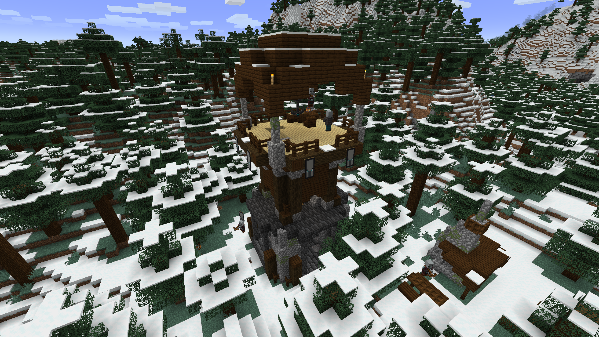
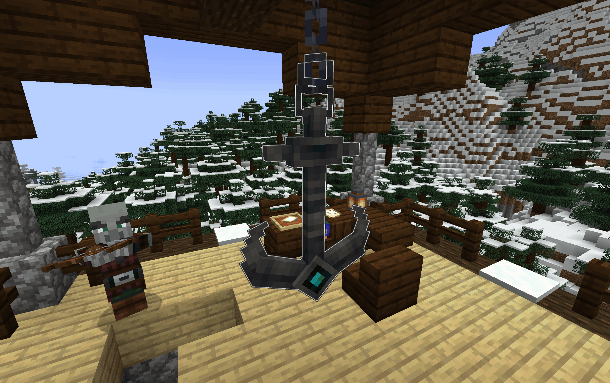

# Whispering Anchors

## Overview

**Whispering Anchors** is a Minecraft mod that adds a convenient way to travel between places the player has already
discovered, without the travel feeling overpowered.

## Content

### Traversal Towers

The most apparent addition to the Overworld is the **Traversal Tower**. These towers generate on the surface above
Deep Dark biomes. Built long ago by an ancient civilization, they were appropriated by illagers who wanted to utilize
their power and use them as transportation hubs.

If you weren't lucky enough to come across a tower yourself, a map leading to the nearest one can be found at pillager
outposts.

The towers are guarded by pillagers and vindicators. Once you've cleared them out, the tower is up for your use.

### Whispering Anchor

In the center of every tower hangs a **Whispering Anchor** — the relic itself. It's fragile and old, so it can't be
collected or crafted.

(an image of an anchor in a traversal tower with a pillager making a jojo pose nearby)

All anchors have default names, but you can rename them with a name tag so you never pick the wrong stop. You can also
color them by using a dye on them.

### Harkening Bell

The anchor itself doesn't have a menu: you'll need a **Harkening Bell** to teleport to it. The part of the past tower
buried underground contains some remains of both the ancient builders and the pillagers. Dig carefully, and you're
guaranteed to find a bell there. Bells also turn up in buried treasure chests from time to time.

Right-click an anchor with the bell to attune it, then ring the bell to be teleported to the anchor it's bound to. You
can always bind the same bell to another anchor.

### Heeding Compass

The past tower also hides a rarer find, the **Heeding Compass**. You might need to loot a few towers before you get one.

Shake the compass, and it points to the nearest tower you haven't discovered yet. Right-click an anchor with the
compass, and it will remember its tower and ignore it from then on. Sneak and right-click to switch modes, and when
shaken again, the compass will point to known anchors instead. To make it forget all anchors, put it in a crafting
table.

## People

**GridExpert** — Author

**Fluffy_Nuar** — Co-Author

**TANC57** — Artist

## Sounds

This project uses free-to-use sounds listed below:

| Name                     | Sound Effects                              | Author                                                         | Source                                                                  | License                                                       |
|--------------------------|--------------------------------------------|----------------------------------------------------------------|-------------------------------------------------------------------------|---------------------------------------------------------------|
| Three Bells, Ship Time   | "harkening_bell_ringing/segment_[0-6].ogg" | [Benboncan](https://freesound.org/people/Benboncan/)           | [Freesound](https://freesound.org/people/Benboncan/sounds/77698/)       | [CC BY 4.0](https://creativecommons.org/licenses/by/4.0/)     |
| Four_Voices_Whispering_6 | "whispers.ogg"                             | [geoneo0](https://freesound.org/people/geoneo0/)               | [Freesound](https://freesound.org/people/geoneo0/sounds/193812/)        | [CC0 1.0](https://creativecommons.org/publicdomain/zero/1.0/) |
| Sword sounds compilation | "harkening_bell_abrupted.ogg"              | [SamsterBirdies](https://freesound.org/people/SamsterBirdies/) | [Freesound](https://freesound.org/people/SamsterBirdies/sounds/345308/) | [CC0 1.0](https://creativecommons.org/publicdomain/zero/1.0/) |